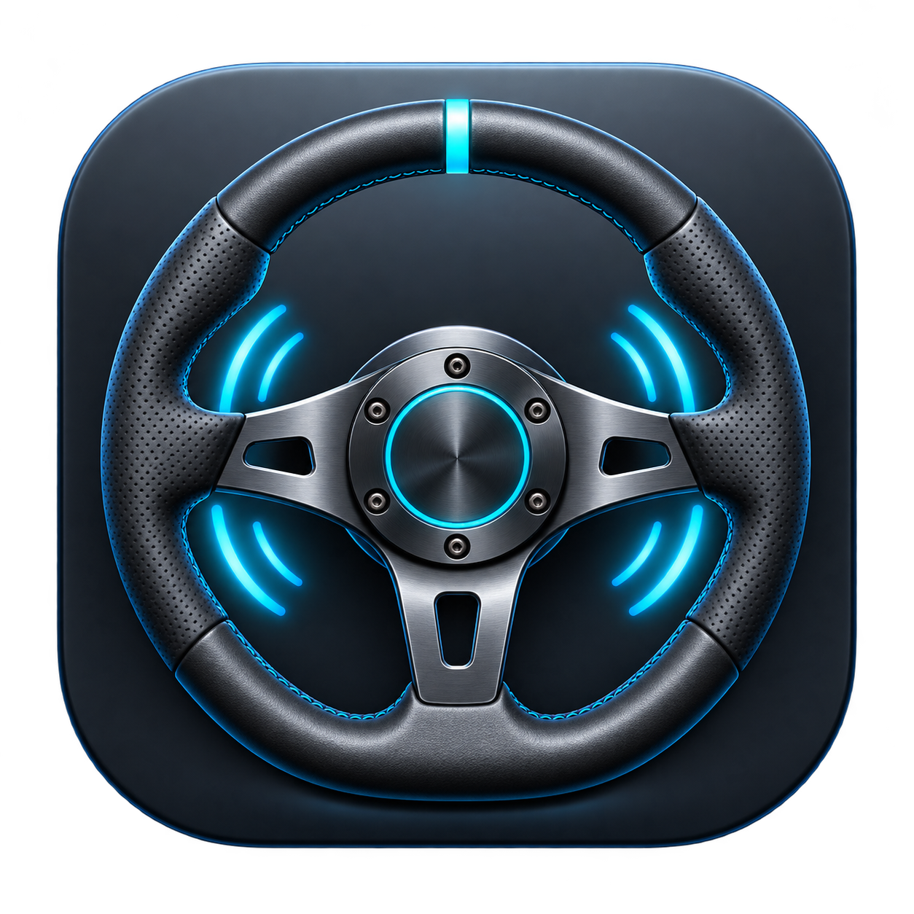

<p align="center"></p>

# Fanatec GFN for macOS

Use a **Fanatec CSL DD** with steering, pedals and constant-force feedback in the native **GeForce NOW** macOS client. The bridge presents the wheel as a Logitech G29 inside a locally prepared GFN copy.

[Download the latest app](https://github.com/sodacore-studios/fanatec-gfn-macos/releases/latest) · [Installation](docs/installation.md) · [Operation](docs/operation.md) · [Compatibility and validation](docs/validation.md)

**Experimental community software.** Assetto Corsa Competizione has been physically tested on Apple Silicon. Other games, wheels and operating systems are not verified. The app is ad-hoc signed, not Apple-notarized. It is not affiliated with Fanatec, NVIDIA or Logitech.

## Get started

1. Download the ZIP for your Mac: **arm64** for Apple Silicon, **x86_64** for Intel.
2. Extract **Fanatec GFN.app**, move it to Applications and follow the [first-launch instructions](docs/installation.md#first-launch).
3. Connect the CSL DD by USB in **red PC mode**, with the pedals connected to the base.
4. Click **Install / repair GFN bridge…** and select your original, supported GeForceNOW.app. The installer creates a separate managed copy. It does not modify the original app.
5. Click **Open GeForce NOW**, sign in and launch the game. Configure the Logitech G29 inputs in the game.
6. Select passthrough strength, then **Start force feedback**. Begin with a low setting on a new setup; **STOP** ends the session.

No compiler, Python installation, hardware adapter or paid Apple Developer membership is required to use the downloaded app. You still need your own supported NVIDIA client and access to the game/service.

## Behavior

- Steering, 25 buttons/hat and two pedals are translated into G29 reports.
- Recognized constant forces and stop commands are translated into CSL DD commands.
- Default: **100% passthrough**, **Unlimited**, **immediate output without a ramp**. Set the driving strength in the game.
- The 250 ms software watchdog sends the neutral/slot-disable/global-stop sequence after valid game force data disappears. Fresh valid data resumes output.
- STOP, normal app shutdown and controller process exit stop the helper. Unknown effects are rejected.
- No system driver, Virtual HID entitlement, global library injection or global macOS security changes are used.

## Supported scope

| Component | Status |
|---|---|
| Hardware | CSL DD, PC mode, USB 0EB7:0020, two pedals connected to base |
| OS / downloads | macOS 13+ build target; Apple Silicon and Intel binaries |
| Physical test | Apple Silicon M3, macOS 27.0.1, Assetto Corsa Competizione |
| GFN versions accepted by installer | 2.0.86.124 and 2.0.89.154, with exact library checksums |
| Other G29-compatible games | May work; input recognition alone does not prove FFB compatibility |
| Linux / Windows | No application support; implementation uses macOS IOKit and AppKit |

A GFN update can remove the bridge or change the protocol. Unknown versions are refused until reviewed; there is no bypass switch. See [troubleshooting](docs/operation.md#troubleshooting).

## Development

Requires macOS with Apple Command Line Tools and Python 3 for build/test orchestration. The runtime is **C and Swift**, not Python.

```sh
python3 scripts/test.py
python3 scripts/coverage.py
python3 scripts/installer_tests.py
python3 scripts/package.py --arch universal --version 0.4.0
```

Tests never pass `--live` or access a physical motor. Downloads contain only project components, never the proprietary NVIDIA client.

See [architecture](docs/architecture.md), [contributing](CONTRIBUTING.md), [release process](docs/releases.md) and [security](SECURITY.md).

## License

GPL-2.0-only. Protocol references and distribution boundaries are listed in [THIRD_PARTY_NOTICES.md](THIRD_PARTY_NOTICES.md). The generated icon contains no vendor branding.
