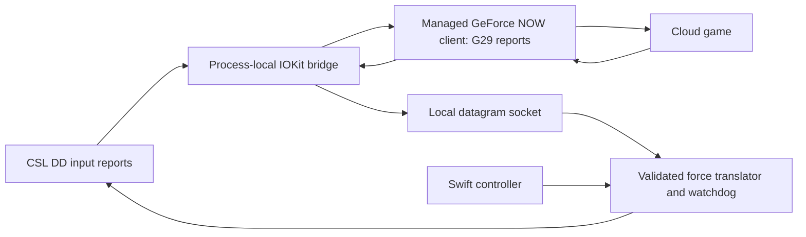

# Architecture

## Components

- `source/bridge.c`: interposes selected IOKit calls only inside the prepared GFN client. It presents VID 046D / PID C24F / version 8900 / interface 0, the G29 report descriptor and translated inputs. Captured G29 output is sent to the local receiver, never blindly written to the base.
- `source/report_map.h`: pure mapping from the CSL DD 34-byte report 1 to a 12-byte G29 report without report ID. Steering comes from bytes 17/18, accelerator byte 20 and brake byte 22. Clutch stays released. Hat and first 25 buttons are preserved.
- `source/ffb_protocol.h`: strict translation of the observed constant-force packet `11 08 LL 80 00 00 00` with zero padding to 16 bytes. Selected stop commands are accepted conservatively; other packets are rejected.
- `source/ffb_wire.h`: datagram structure, metadata/freshness validation and watchdog predicate.
- `source/ffb_receiver.c`: socket loop, USB writer, gain limit, optional duration, parent monitoring and shutdown. Hardware access requires explicit `--live`; default is DRY_RUN. More than one matching base is refused.
- `source/runtime_paths.h`: resolves per-user runtime files independently of the checkout/build machine.
- `source/Installer.swift`: checksum-gated local copy, bounded Mach-O patching, ad-hoc signing, backup and rollback.
- `source/controller.swift`: native AppKit GUI and child process lifecycle. Runtime contains no Python dependency.

## Force translation

The Logitech level is interpreted as `(LL - 128) / 128`, then multiplied by configured gain. Optional inversion is a developer flag; normal operation keeps the validated direction. A nonzero force becomes a Fanatec 8-byte constant-force slot command with signed force scaled by 32767 and offset by 32768. Near-zero output becomes a slot-0 disable command. All live stop transitions overwrite slot 0 with neutral high-resolution force, disable slot 0 explicitly, and send global stop. This avoids relying solely on global stop to clear retained force.

Packets must have exact size, expected magic/type/report ID, zero reserved field and a timestamp no more than 100 ms old. Future timestamps are rejected. The drain loop is bounded so packet floods cannot indefinitely postpone watchdog checks. The watchdog stops after more than 250 ms without valid force data. The normal session uses its full selected gain immediately; the separate diagnostic ramp mode is not used by the GUI.

## Security boundaries and limitations

The native installer changes a copy of a proprietary client and relaxes library validation only for that copy. It neither installs a kernel/system extension nor patches the original app. There is no network service in the bridge and no global `DYLD_INSERT_LIBRARIES` configuration. A local same-user process can still send socket packets: the socket is not an authentication boundary against a compromised account.

Client updates can break assumptions. Version/checksum gates are intentional, but they do not constitute a full audit of NVIDIA or its update system. Runtime bridge detection checks for the injected load path; it is not a complete integrity verification. The controller and receiver are not a hardware-certified safety system.
